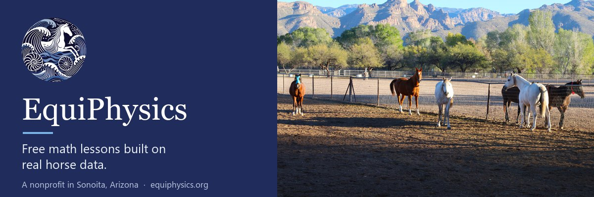
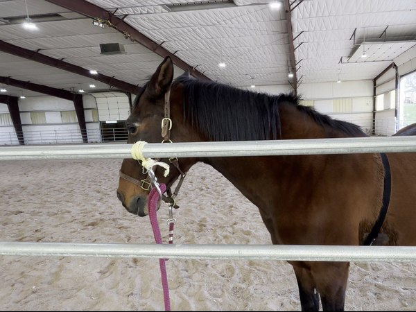
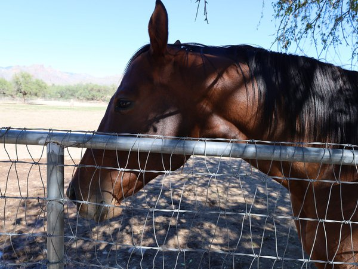
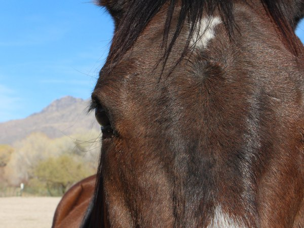
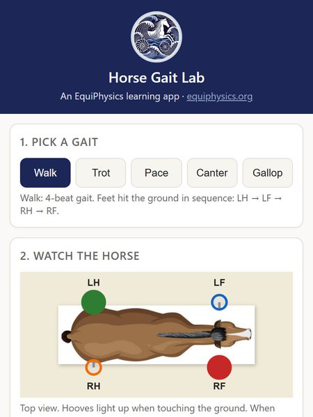
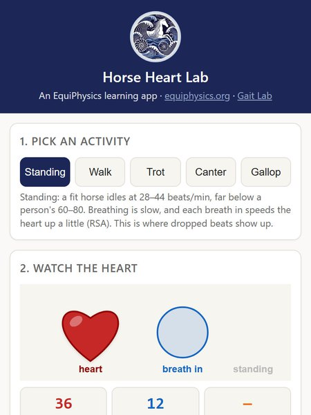
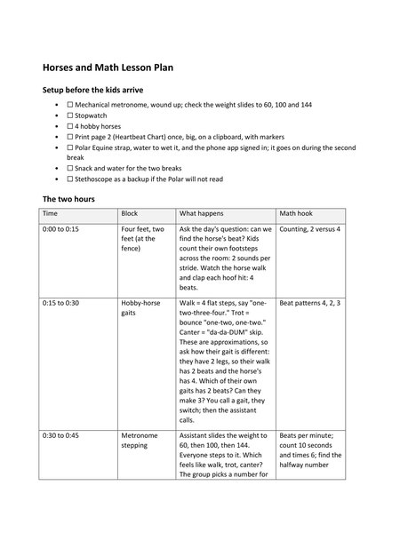
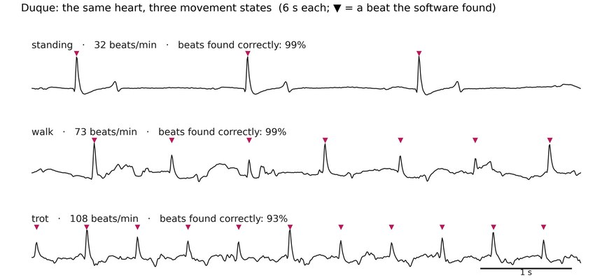
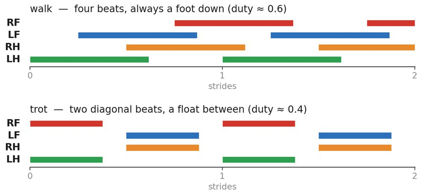

## Hi! We're EquiPhysics

EquiPhysics (Equiphysics Institute) is a small 501(c)(3) nonprofit in Sonoita, Arizona. We study how horses move and breathe with tools from math and engineering. Then we turn what we learn into free lessons and apps for classrooms.

Our horses are the teachers. Every lesson here is built on their real strides and heartbeats, from counting hoofbeats with six-year-olds to modeling a heartbeat with a differential equation. Most lessons need no horse and no barn, only a browser. All of them are free.

[Website](https://www.equiphysics.org) · [Free tools and lessons](https://equiphysics.github.io/) · [For teachers](https://www.equiphysics.org/for-teachers) · [Donate](https://www.equiphysics.org/donate) · [Get our news](https://www.equiphysics.org/#news)

### In pictures

<table>
<tr>
<td width="33%"> Duque wears a heart-rate strap around his girth while he stands at the rail.</td>
<td width="33%"> Jackson checks out the camera from the paddock fence.</td>
<td width="33%"> Jaime comes in close to see what the camera is.</td>
</tr>
<tr>
<td width="33%"> The free Horse Gait Lab app: pick a gait and watch the hooves light up.</td>
<td width="33%"> The free Horse Heart Lab app: a horse heartbeat from standing still to a gallop.</td>
<td width="33%"> Horses and Math, a two-hour K-6 lesson plan: hoofbeats, heartbeats, and counting.</td>
</tr>
</table>

<table>
<tr>
<td width="50%"> The same heart at three speeds: Duque standing, walking, and trotting.</td>
<td width="50%"> Walk and trot as footfall bars: four even beats, then two diagonal beats with a float.</td>
</tr>
</table>

### Start here

- **[Horse Gait Lab](https://equiphysics.github.io/web-apps/)**: pick a gait, watch the hooves light up, and compare the model with real strides from a sensor session.
- **[Horse Heart Lab](https://equiphysics.github.io/web-apps/heart/)**: read a horse ECG, watch breathing change the heart rate, and compare the model with Duque's own heartbeats.
- **[Lessons and labs](https://github.com/equiphysics/education)**: K-12 labs with worksheets, teacher guides, answer keys, and slides, plus college courses, real horse data, and notebooks that run free in Google Colab.
- **[Free tools and lessons page](https://equiphysics.github.io/)**: the apps, the lessons, and the data in one place.

### Our repositories

- [education](https://github.com/equiphysics/education): free lessons built on our horses' real strides and heartbeats.
- [web-apps](https://github.com/equiphysics/web-apps): the Horse Gait Lab and Horse Heart Lab browser apps.
- [equiphysics.github.io](https://github.com/equiphysics/equiphysics.github.io): our free tools and lessons page.

Our founder Laura Miller's research code, including tutorials for immersed boundary software, is at [github.com/fairyflies9](https://github.com/fairyflies9).

### Help keep these lessons free

Did you teach one of our lessons? Please [tell us how it went](https://www.equiphysics.org/for-teachers#tell-us)! It takes a minute, and it helps us keep the lessons free.

Can't give right now? You can still help a lot. Share our work, and follow us on [Instagram](https://www.instagram.com/equiphysics_institute/), [Facebook](https://www.facebook.com/profile.php?id=61579151426160), [LinkedIn](https://www.linkedin.com/company/equiphysics-institute/), and GitHub. Follows and shares help us show grant funders that people value this work.

If you can give, every gift helps: [equiphysics.org/donate](https://www.equiphysics.org/donate). Equiphysics Institute is a 501(c)(3) nonprofit, EIN 39-3732120.
